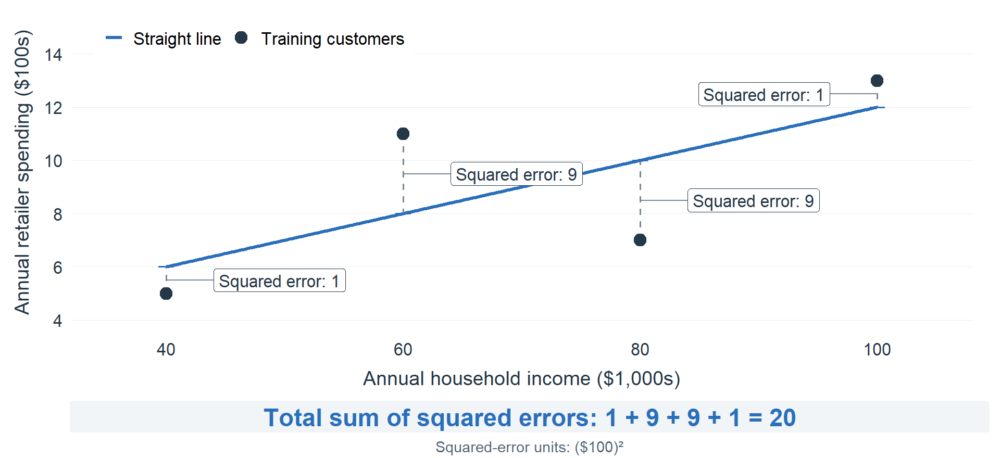
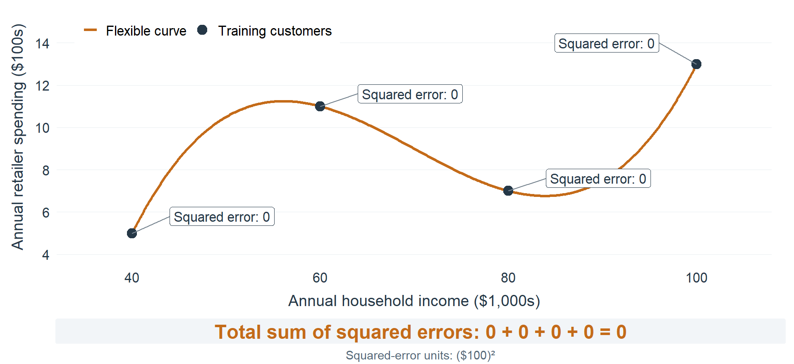
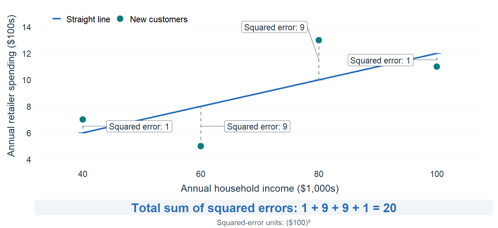
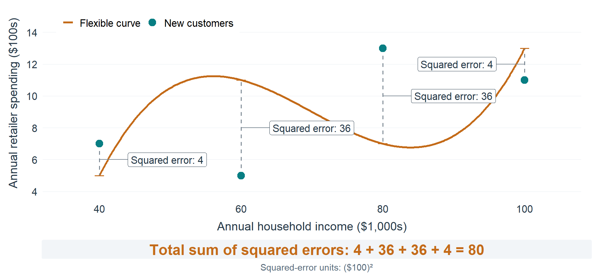

## Today's Learning Goals

- Distinguish learning about spending relationships from predicting customer spending.
- Explain underfitting and overfitting, and why training fit alone is insufficient.
- Fit customer models on training data and compare held-out predictions using MAE.
- Recommend useful customer information while explaining the limits of the evidence.

## Marketing Analytics Process

<center>
{width="900px"}
</center>

## Inferential Modeling Workflow

<center>
{width=900px}
</center>

---

{width=850px}

## Review the Workflow

<center>
{width=900px}
</center>

## Inference and Prediction | Two Questions for Our Client

The home-goods retailer wants to understand customer value before planning outreach.

- **Inference:** how does past spending differ with household characteristics? Interpret coefficients and uncertainty, and consider missing parts of the story.
- **Prediction:** how accurately can we estimate past spending for similar customers whose purchase histories have not yet been linked to their survey records?

The same regression can serve both purposes.

## Model Comparison Review

Lecture 08 compared models on the **same customers** using $R^2$.

Adding household composition improved the spending model. Adding visits and product views contributed almost nothing.

All of the customers' data was used to train the models. 

**Today's Question:** Are the relationships learned by the model applicable to other customers?

## Models Can "Memorize" Data

- Adding predictors to a regression will **always** increase $R^2$ (even if by a tiny amount).
- Those additional predictors can sometimes capture **sample-specific variation** rather than generalizable relationships between our dependent and independent variables.

## Analogy: Students and Models

Imagine two students with different strategies for studying for a test. Each has access to the same practice test and class materials.

- Student 1 memorizes the practice test, and can get 100% when taking it.
- Student 2 studies principles from class notes and homework, then takes the practice test once and gets 80%.

Which student will **most likely** perform best on the actual test?

## Underfitting and Overfitting

We want a model that tells an accurate version of our story without **missing important details** or **focusing too much on unimportant details**.

- **Underfitting:** missing useful structure, such as relevant household characteristics.
- **Overfitting:** learning sample-specific noise that does not generalize.

<center>
{width=800px}
</center>

## Can Our Existing Model Evaluation Metrics Help?

- **$R^2$:** proportion of variation in the observed outcome explained by the fitted model.
- **Adjusted $R^2$:** accounts for the number of predictors. It can fall when an added predictor contributes too little to training fit.

Both measure how much variation the model can explain in the training data. **Overfitting** the training data will produce a very high $R^2$.

## Training Fit Cannot Tell the Whole Story

<center>
{width=800px}
</center>

Even a penalty for extra predictors is not a substitute for checking observed outcomes outside the training sample.

## Four Customers: Fit a Simple Spending Model

A home-goods retailer uses household income to estimate annual customer spending. These four **illustrative customers** are our training data.

<center>
{width=900px}
</center>

## Same Customers: Fit a More Flexible Model

The curve bends to fit all four training customers exactly. Its training error is zero. Does that make it better for the retailer?

<center>
{width=900px}
</center>

## Simple Model With Four New Customers

Four different customers have the same income levels and different spending. Apply the **original straight line** to these new customers, without refitting it.

<center>
{width=900px}
</center>

## Flexible Model With Four New Customers

Apply the **original flexible curve** to those same new customers. Which model would you trust to estimate spending for other customers?

<center>
{width=900px}
</center>

## So What's the Goal With Over- vs. Under-Fitting?

We want a model that has similar predictive error on:

- the customer data it trained on, and
- brand new customer data.

## Let's Apply These Concepts to our Household Retailer Data

The retailer has household surveys and website records for 10,000 customers. It wants useful estimates of **previous 12-month spending** for similar customers.

We will compare three familiar spending models:

- **Income:** household resources alone.
- **Household:** resources, housing, age, education and household composition.
- **Browsing:** the same household information, plus visits and product views.

We will assess whether the extra information from adding the household and browsing predictors is useful for improving predictions.

## Predictive Fit

We will "set aside" (holdout) some customers before fitting the models. These holdout customers will let us check predictions on data the models have not used for estimation.

- Useful variables will improve predictions for *training* and *holdout* customers.
- Variables that are *not* useful (noise) may improve predictions for *training* customers, but will not improve (or will degrade) predictions for *holdout* customers.

## Getting Started

```{r message=FALSE}
library(tidyverse)
library(tidymodels)

customers <- read_csv("home_goods_customers.csv", show_col_types = FALSE)
```

Use `data_dictionary.pdf` to check meanings and units.

Our outcome remains `PreviousSpend`: dollars spent at this retailer over the previous 12 months.

## Keep the Model Comparisons Comparable

```{r}
customer_model_data <- customers |>
  drop_na(PreviousSpend, HouseholdIncome, HouseholdSize, Homeowner,
          HomeSizeSqFt, Age, Education, ChildrenAtHome,
          SiteVisits30d, ProductViews30d) |>
  mutate(IncomeThousands = HouseholdIncome / 1000,
         HomeSizeHundreds = HomeSizeSqFt / 100)

nrow(customer_model_data)
```

As in Lecture 08, **9,603 customers** have the observed values needed for all three models. Use this same sample for every comparison.

## Reuse Our Education Indicators

```{r}
customer_model_data <- customer_model_data |>
  mutate(
    EducationSomeCollege = if_else(Education == "Some college/associate", 1, 0),
    EducationBachelors = if_else(Education == "Bachelor's", 1, 0),
    EducationGraduate = if_else(Education == "Graduate", 1, 0)
  )
```

The baseline remains **high school or less**. Income is in thousands of dollars; home size is in hundreds of square feet.

## Data Splitting

- **Training data:** observations used to estimate the model's coefficients.
- **Testing data:** held-out observations used to check predictions against actual outcomes.

```{r}
set.seed(42)
customer_split <- initial_split(customer_model_data, prop = 0.80)

customer_split
```

The split contains **7,682 training customers** and **1,921 testing customers**. The seed makes this random split reproducible.

## Access the Training and Testing Data

```{r}
customer_train <- training(customer_split)
customer_test <- testing(customer_split)

nrow(customer_train)
nrow(customer_test)
```

`initial_split()` stores which rows belong to each set; it does not add a predictor to the customer table.

These are different customers from the same period. With no dates in the file, this is **not a test of next year's spending**.

## Fit with Training Data | Income Alone

Refit the income model using only the training customers.

```{r}
fit_income <- linear_reg() |>
  set_engine("lm") |>
  fit(PreviousSpend ~ IncomeThousands, data = customer_train)
```

The testing customers **must not** be used to estimate coefficients.

## Fit with Training Data | Household Information

```{r}
fit_household <- linear_reg() |>
  set_engine("lm") |>
  fit(PreviousSpend ~ IncomeThousands + HouseholdSize + Homeowner +
        HomeSizeHundreds + Age + EducationSomeCollege +
        EducationBachelors + EducationGraduate + ChildrenAtHome,
      data = customer_train)
```

This is Lecture 08's household-composition model, fitted on the training sample.

## Fit with Training Data | Add Browsing

```{r}
fit_browsing <- linear_reg() |>
  set_engine("lm") |>
  fit(PreviousSpend ~ IncomeThousands + HouseholdSize + Homeowner +
        HomeSizeHundreds + Age + EducationSomeCollege +
        EducationBachelors + EducationGraduate + ChildrenAtHome +
        SiteVisits30d + ProductViews30d,
      data = customer_train)
```

Add the browsing variables.

We know site visits and product views are collinear, and we should only use one. For demonstrating over-fitting, we're going to use both today.

## Compare Training Fit

```{r}
bind_rows(
  income = glance(fit_income),
  household = glance(fit_household),
  browsing = glance(fit_browsing),
  .id = "model"
) |>
  select(model, r.squared, adj.r.squared) |>
  as.data.frame()
```

$R^2$ indicates that adding household information and browsing information improves model fit...but this relies on *training* sample data only. **We will not rely on $R^2$ for model selection.**

## Predict Spending for Held-Out Customers

```{r, eval=FALSE}
# generate predictions and add them as a new column to customer_test data
predictions_household <- fit_household |>
  predict(new_data = customer_test) |>
  bind_cols(customer_test)

# selection the ACTUAL spend and PREDICTED spend, and display  first five  rows
predictions_household |>
  select(PreviousSpend, .pred) |>
  slice_head(n = 5)
```

## Predict Spending for Held-Out Customers

```{r, echo=FALSE}
# generate predictions and add them as a new column to customer_test data
predictions_household <- fit_household |>
  predict(new_data = customer_test) |>
  bind_cols(customer_test)

# selection the ACTUAL spend and PREDICTED spend, and display  first five  rows
predictions_household |>
  select(PreviousSpend, .pred) |>
  slice_head(n = 5)
```

`.pred` is predicted spending; `PreviousSpend` is actual spending. Each row pairs the prediction with the outcome for the **same held-out customer**.

## How Far Off Are Our Predictions?

We quantify how accurate our predictions are using an **error measure**:

**Root mean squared error (RMSE)** is the square root of the average squared prediction error:

$$\text{RMSE} = \sqrt{\frac{1}{n}\sum_{i=1}^{n}(y_i-\hat{y}_i)^2}$$

**Mean Absolute Error (MAE)** is the average absolute prediction error:

$$\text{MAE} = \frac{1}{n}\sum_{i=1}^{n}|y_i-\hat{y}_i|$$

## Which Error Measure Should I Use?

There are lots of error measures: RMSE, MAE, etc.

Both MAE and RMSE use the original units of the dependent variable. For this class, I recommend **MAE** because it is the **average absolute prediction error**: the average dollar amount by which our spending predictions miss. RMSE gives larger misses more weight.

## Evaluate our Prediction Accuracy

```{r}
predictions_household |>
  mae(truth = PreviousSpend, estimate = .pred)
```

*Lower* is *better* when it comes to error measures.

Here, MAE is about **$119**.

## Compare Hold-Out MAE Across Models {.smaller}

```{r}
predictions_income <- fit_income |>
  predict(new_data = customer_test) |>
  bind_cols(customer_test)

predictions_browsing <- fit_browsing |>
  predict(new_data = customer_test) |>
  bind_cols(customer_test)

bind_rows(
  income = mae(predictions_income, truth = PreviousSpend, estimate = .pred),
  household = mae(predictions_household, truth = PreviousSpend, estimate = .pred),
  browsing = mae(predictions_browsing, truth = PreviousSpend, estimate = .pred),
  .id = "model"
) |>
  select(model, .estimate) |>
  as.data.frame()
```

Which information improves predictions? Is the browsing difference meaningful for the client?

## What Did We Learn for the Client?

| Model | Held-out MAE |
|---|---:|
| Income only | $138.38 |
| Household information | $119.25 |
| Household + browsing | $119.28 |

Household information lowers MAE by about **$19** relative to income alone. The browsing difference is not meaningful.

This split supports using the household model for predictions.

## What About Training Data Predictions?

```{r, eval=FALSE}
fit_household |>
  predict(new_data = customer_train) |>
  bind_cols(customer_train) |>
  mae(truth = PreviousSpend, estimate = .pred)

fit_browsing |>
  predict(new_data = customer_train) |>
  bind_cols(customer_train) |>
  mae(truth = PreviousSpend, estimate = .pred)
```

## What About Training Data Predictions?

```{r, echo=FALSE}
fit_income |>
  predict(new_data = customer_train) |>
  bind_cols(customer_train) |>
  mae(truth = PreviousSpend, estimate = .pred)

fit_household |>
  predict(new_data = customer_train) |>
  bind_cols(customer_train) |>
  mae(truth = PreviousSpend, estimate = .pred)
```

Training MAE measures the average absolute error for customers the models have **already seen**. Adding predictors does not guarantee a lower MAE.

## Training and Testing | Read the Evidence {.smaller}

| Model | Training MAE | Testing MAE |
|---|---:|---:|
| Income only | $136.83 | $138.38 |
| Household information | $120.23 | $119.25 |
| Household + browsing | $120.24 | $119.28 |

- Poor performance in both sets can suggest missing useful variables (*i.e.*, room to improve)
- A large improvement **only in training** can suggest **overfitting**.
- Here, the household information helps; browsing adds almost nothing in either set.

Test MAE can be lower than training MAE by chance.

## Let's See Some Actual Overfitting

This **linear regression** uses all **12 customer variables** and many combinations of them (interactions), estimating **1,946 coefficients**. The extra flexibility lets it fit patterns specific to the training customers.

```{r eval=FALSE}
# Include main effects and interactions involving up to four variables.
fit_overfit <- linear_reg() |>
  set_engine("lm") |>
  fit(PreviousSpend ~ (IncomeThousands + HouseholdSize + Homeowner +
        HomeSizeHundreds + Age + Education + ChildrenAtHome + Region +
        SiteVisits30d + ProductViews30d + DaysSinceLastVisit + EmailEngagement90d)^4,
      data = customer_train)
```

## Let's See Some Actual Overfitting

These results us the same customers and split as before. **Holdout error is 55% higher than training error.** The simpler household model predicts new customers more accurately than the model with over **1,900** variables.

```{r echo=FALSE}
# Include main effects and interactions involving up to four variables.
fit_overfit <- linear_reg() |>
  set_engine("lm") |>
  fit(PreviousSpend ~ (IncomeThousands + HouseholdSize + Homeowner +
        HomeSizeHundreds + Age + Education + ChildrenAtHome + Region +
        SiteVisits30d + ProductViews30d + DaysSinceLastVisit + EmailEngagement90d)^4,
      data = customer_train)

overfit_train_mae <- fit_overfit |>
  predict(new_data = customer_train) |>
  bind_cols(customer_train) |>
  mae(truth = PreviousSpend, estimate = .pred)

overfit_test_mae <- fit_overfit |>
  predict(new_data = customer_test) |>
  bind_cols(customer_test) |>
  mae(truth = PreviousSpend, estimate = .pred)
```

| Model | Training MAE | Holdout MAE |
|---|---:|---:|
| Household information | $120.23 | $119.25 |
| Larger linear regression | $101.78 | $158.11 |

## What Am I Supposed to Do?

1. Start with plausible models and a business question.
2. Estimate coefficients using training data.
3. Compare predictions with actual outcomes for held-out customers.
4. Weigh predictive performance alongside simplicity and the information needed.

Do **not** keep changing the split until a preferred model wins. Repeated model selection needs validation and a separate final test (we will talk about this later).

## Predictive Validation and Customer Profile Predictions

| New data | What can we learn? |
|---|---|
| Held-out customers with observed spending | Compare predictions with actual outcomes using MAE. |
| Specified customer profiles | Describe model-based spending differences; no new outcomes have been observed. |

A low MAE does not establish the effect of sending an email or changing a household characteristic. It also does not guarantee accuracy in a different time period or customer population.

## Live Coding | Dependable Customer-Value Estimates

Leadership wants **dependable estimates of customer value** and advice about which household information is worth collecting for customers whose purchase histories are not yet linked.

What should "dependable" mean for this decision?

After fitting a model and generating predictions, consider the following:

- Let's assume the client wants to use these estimates to conduct outreach. What caveats should they be aware of?
- Let's assume the client has a fixed budget of \$1000 for outreach, and that it costs \$10 per customer to conduct outreach. Which customers should the client contact?

## Wrapping Up

- More predictors can improve training fit without adding useful predictive information.
- Fit on training customers; assess predictions against held-out outcomes.
- Interpret MAE in spending dollars and weigh improvements against information needs.
- Similar-customer prediction and the effect of an intervention are different questions.

*Next Time*: Preprocessing data.

*Supplementary Material*: *Tidy Modeling with R*, Chapter 9.1–9.2.

## Exercise 8 | A Useful Customer-Spending Model

The retailer wants dependable estimates of past annual spending for customers whose purchase records have not yet been linked to their household surveys.

Use `home_goods_customers.csv` and `data_dictionary.pdf`. The outcome is `PreviousSpend`. Choose **two plausible models** and use them to predict spending.

Reserve 25% of customers as the holdout set (using random seed 42); the remaining 75% will be the training set. Remember to report sample sizes.

## Exercise 8 | Evidence and Recommendation {.smaller}

Submit a Word report rendered from Quarto containing your code, results and interpretation. Include:

- Your two models and a brief written description for the reasoning behind the variables you included. Estimate them using only the training customers.
- A comparison of $R^2$ and holdout MAE in dollars. Explain whether these measures favor the same model and why they might differ.
- Your preferred model and the dollar improvement in predictive performance, if any, compared to the other model. Discuss whether that improvement is useful for this client.
- Discuss why this assessment does not guarantee that your chosen model would provide accurate predictions of spending in a later year.

Upload the report to Canvas's **Exercise 8** assignment.
